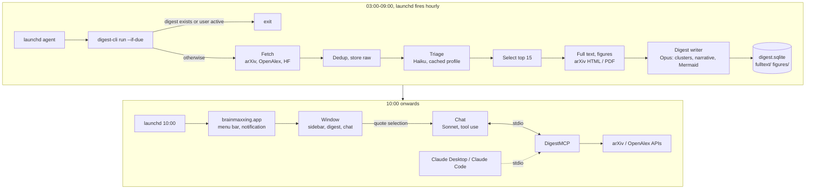

# brainmaxxing

Reading 300 to 500 new arXiv papers a day is not possible, so this app does it for you. Every night it collects
the new arXiv, OpenAlex and HuggingFace papers in your areas, ranks them against your interest profile with Claude,
and at 10:00 shows a digest of the ones worth your time: figures from the papers, generated diagrams, links to the
originals. The digest has a chat that can quote any fragment of it and look papers up through an MCP server; the
same server plugs into Claude Desktop or Claude Code. Bring your own API key.

Everything below works. What is missing for a public release is a Developer ID for signing and notarization,
onboarding and Sparkle updates.

## 1. How it fits together



| Target | Kind | Role |
|---|---|---|
| `DigestCore` | SwiftPM library | Sources, ranking, full text, digest, LLM client, storage, scheduling policy, prompts |
| `digest-cli` | executable, bundled in the app | What launchd runs: `run`, `status`, `show`, `cost`, `install-agent`, `record-golden` |
| `DigestMCP` | executable, bundled in the app | MCP server over stdio for the app's chat, Claude Desktop and Claude Code |
| `brainmaxxing` | SwiftUI app (XcodeGen) | Window, menu bar, notifications, settings, web view bridge, chat UI |

## 2. Pipeline

- **Fetch.** arXiv is the primary source (Atom API, one request per 3 seconds, 429/503 retried). OpenAlex adds
  journal papers that never reach arXiv; HF Daily Papers is a separate section, not a ranking input. The window
  starts four days before the last complete run (arXiv announces with a lag), capped at seven; only papers with no
  score from any earlier run go to triage.
- **Triage.** Haiku scores batches of 25 abstracts against the interest profile plus the 20 newest thumbs up and
  down from the app, all behind one cached prefix. The top 15 with score 6 or more that were never shown before are
  selected; a quiet weekend therefore shows the week's best unshown papers.
- **Full text.** arXiv HTML first, then the PDF through PDFKit (text only), two figures per paper. Any failure
  leaves the paper abstract-only and never fails the run.
- **Digest.** One streamed Opus call over a cached bundle returns clusters with a connecting narrative, per paper
  the essence, why it matters, caveats and an optional Mermaid diagram, plus the HF section and trend notes. If the
  call fails, the ranked list stays, the run is partial, and `digest-cli run --stage digest` retries that stage.
  A forced re-run the same day adds a new edition with only the papers not shown yet.
- **Cost.** Every call is logged with its tokens and USD. A call whose worst case would pass the daily cap
  (default $4) is refused and the run finishes with what it has.

## 3. Scheduling

Nothing runs while the Mac sleeps, so the nightly run is a window, not a moment: `com.brainmaxxing.run` fires every
hour from 03:00 to 08:00 and `digest-cli run --if-due` exits unless no digest exists today, the hour is inside the
window and the user has been idle for 15 minutes. `com.brainmaxxing.show` opens the app hidden at 10:00 to post
the notification; if the Mac was closed all night it offers "Run now". `digest-cli install-agent` writes both plists
to `~/Library/LaunchAgents` and loads them; `uninstall-agent` reverts.

## 4. Storage

```
~/Library/Application Support/brainmaxxing/
  digest.sqlite        papers, runs, llm_calls, triage_scores, figures, digests (date + edition), clusters,
                       shown_papers, feedback, conversations, chat_messages, quotes; FTS5 over papers and chat
  config.json          categories, interest profile, models, budget, schedule, language
  fulltext/<id>.txt    figures/<id>/<n>.png    raw/<run_id>/ (API responses, pruned after 30 days)
```

## 5. App

One window: a sidebar with digests by date and a full-text search over all papers, the digest itself in a
`WKWebView` (markdown-it, KaTeX and mermaid.js vendored, offline), and a chat inspector with one conversation per
digest. Selecting text in the digest and pressing "Ask about this" (Cmd-Shift-L) puts the fragment into the chat as
a quote with the paper id. Thumbs up and down per paper feed the next triage; a menu bar item shows status, cost
today and "Make digest now". Settings cover categories, the profile, models, budget, the schedule and the API key.

## 6. MCP server

Register the bundled binary in Claude Desktop or Claude Code:

```
claude mcp add brainmaxxing -- /Applications/brainmaxxing.app/Contents/MacOS/DigestMCP
```

| Tool | Does |
|---|---|
| `search_arxiv(query, categories?, since?, max?)` | arXiv API search |
| `get_paper(id)` | metadata and abstract, local store first |
| `get_fulltext(id, max_chars?, offset?)` | stored full text, fetched if missing |
| `search_openalex(query, since?, max?)` | journal papers |
| `get_citations(id, direction, max?)` | OpenAlex references or cited-by |
| `search_digests(query, max?)` | FTS over past digests and chat |
| `get_digest(date, edition?)` | a stored digest as JSON |

Resources: `digest://today`, `digest://<date>`, `paper://<id>`. The server gets only `HOME`, `PATH`, `TMPDIR`,
`LANG` and `BRAINMAXXING_HOME`; API keys never reach it.

## 7. Configuration

`config.json` with its defaults (`Config.swift` is the source of truth):

```json
{
  "categories": ["cs.LG","cs.AI","cs.MA","cs.CL","cs.CV","cs.RO","math.DG","math.AT","math.PR","math.ST","stat.ML"],
  "interest_profile": "free text: what you care about, what you don't",
  "top_n": 15, "min_score": 6, "daily_budget_usd": 4.0,
  "models": { "triage": "claude-haiku-5-5", "digest": "claude-opus-5-5", "chat": "claude-sonnet-5-5" },
  "schedule": { "window_start": 3, "window_end": 9, "show_at": 10, "idle_minutes": 15 },
  "language": "ru", "explanation_level": "engineer",
  "sources": { "openalex": true, "hf_papers": true }, "hf_top_k": 10
}
```

Prompts are versioned files in `Sources/DigestCore/Prompts/` with a JSON schema each; the version used is recorded
with every run.

## 8. Build and run

```
brew install xcodegen
swift build
ANTHROPIC_API_KEY=... swift run digest-cli run --force  # a real run from the terminal
xcodegen generate && xcodebuild -project brainmaxxing.xcodeproj -scheme brainmaxxing -configuration Release build
```

The app build embeds `digest-cli` and `DigestMCP` next to its own binary. First launch: paste the API key in
Settings, write the profile, pick categories, "Install nightly agent".
