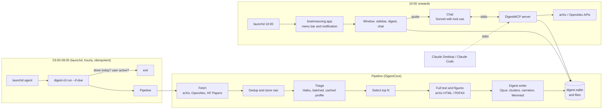

# brainmaxxing

A macOS app that reads the new arXiv, OpenAlex and HuggingFace papers in your areas every night, ranks them
against your interest profile with Claude, and at 10:00 shows a readable digest of the ones worth your time:
figures from the papers, generated diagrams, links to the originals, and a chat that can quote any fragment of
the digest and look papers up through an MCP server.

Stack: Swift 6, SwiftUI, macOS 26, GRDB (SQLite + FTS5), WKWebView for the digest body, the Swift MCP SDK and
the Anthropic Messages API (Haiku for triage, Opus for the digest, Sonnet for chat). Bring your own API key.

Current state: the nightly pipeline, the app, chat with MCP tools, scheduling and the secondary sources all
work. What is missing for a public release is signing and notarization with a Developer ID, onboarding and
Sparkle updates.

## 1. How it fits together



One library and three executables:

| Target | Kind | Role |
|---|---|---|
| `DigestCore` | SwiftPM library | Everything that is not UI: sources, ranking, full text, digest, LLM client, storage, scheduling policy, prompts |
| `digest-cli` | SwiftPM executable, bundled in the app | Entry point for launchd. `run`, `status`, `show`, `cost`, `prompts`, `record-fixture`, `record-golden`, `install-agent`, `uninstall-agent` |
| `DigestMCP` | SwiftPM executable, bundled in the app | MCP server over stdio. Used by the app's chat and by Claude Desktop or Claude Code |
| `brainmaxxing` | SwiftUI app (XcodeGen) | Window, menu bar item, notifications, settings, web view bridge, chat UI |

The app target is thin on purpose. If something in it does more than present state or talk to the OS, it
belongs in `DigestCore`.

## 2. Pipeline

### 2.1 Fetch

**arXiv** is the primary source. The Atom API is queried with `cat:cs.LG OR cat:cs.AI OR ...`,
`sortBy=lastUpdatedDate`, 1000 entries per page and at most 10 pages; hitting the page cap inside the window
marks the run partial. Default categories: `cs.LG cs.AI cs.MA cs.CL cs.CV cs.RO math.DG math.AT math.PR
math.ST stat.ML`. Only papers first published inside the window are kept; revisions of older papers are dropped
unless `include_reversions` is on. All arXiv requests (API, HTML, images, PDF) share one limiter of one request
per 3 seconds. HTTP 429 and 503 are retried up to three times.

**OpenAlex** catches journal papers that never reach arXiv. The works endpoint is filtered by
`from_publication_date`, the configured `openalex_subfields`, `type:article`, `has_abstract:true` and
`primary_location.source.is_core:true`, anonymously (no key, no `mailto`), up to `openalex_max_per_run` rows.
Rows with any arXiv location are dropped as duplicates (arXiv is the source of truth), retracted and paratext rows
are dropped too. Kept papers have an OpenAlex id (`W...`), a venue and a DOI, are triaged together with the arXiv
papers and go to the digest abstract-only.

**HuggingFace Daily Papers** is a separate community section, not a ranking input. The JSON API is read for the
run's date and up to three days before. After selection, the top `hf_top_k` papers by upvotes that are not already
in an earlier digest and not in today's ranked list go into their own section.

OpenAlex and HF are secondary: when one of them fails the run records a line in its error summary and goes on.

The window starts `announce_lag_days` (default 4) before the start of the last complete run and is capped at
`window_cap_days` (7). arXiv serves a paper only from the announcement after its submission, so the window has to
overlap the previous one; the overlap is fetched again, but only papers without a triage score from any earlier
run are sent to triage. Raw API responses are kept per run for replay.

### 2.2 Triage (Haiku)

Batches of about 25 `(id, title, abstract, categories, authors)` go to Haiku. The system prompt is the user's
interest profile plus the 20 newest thumbs up / thumbs down from the app, read once per run so every batch shares the
cached prefix; a vote in the app changes the next run's prompt. The output is a tool call with
`{id, score 0-10, tags, one_line}`.

Selection takes the top N (default 15) with score at least `min_score` (6) from every scored paper of the window
that has not yet appeared in a digest. A quiet day (arXiv announces nothing on Friday and Saturday nights) therefore
shows the week's best papers that were not shown yet; "nothing new" appears only when nothing in that pool reaches
the minimum. Everything below the cut stays in the database with its score and is searchable from the app.

### 2.3 Full text and figures (top N only)

`arxiv.org/html/<id>v<n>` is tried first, then `arxiv.org/html/<id>`, then the PDF through PDFKit, each step
only on a 404. Any other failure leaves the paper abstract-only and never fails the run. Text is stored complete
on disk and truncated to `fulltext_max_chars` (48 000) for the digest call. Figures: the first two that download
and decode, re-encoded to PNG with the longest side at most 1600 px. A paper whose text is already stored is not
fetched again. Figure extraction from PDFs is not implemented yet; PDFs give text only.

### 2.4 Digest writer (Opus)

One streamed call over a cached bundle of the selected papers, answered through a tool call with:

- `clusters`: groups of overlapping papers with a name and a narrative that connects them;
- `papers`: per paper the contribution paraphrased for an ML engineer, why it matters, caveats, which figure to
  show, an optional Mermaid diagram of the method and links;
- `hf_section`: the HF Daily Papers list with one line each;
- `trend_notes`: what recurs across days (the model sees the last seven digests' cluster names).

The language is Russian with English terms by default (`language`), titles are never translated, and the
explanation level is `engineer` (no definitions of standard terms). Two other levels, `two_layer` and `intro`,
switch only the prompt; the schema has `essence` and `detail` for every paper regardless.

The pipeline enforces the schema semantics: unknown ids are dropped, clusters with fewer than two papers are
dissolved, a paper the model skipped is filled in from its triage line and flagged. A response without the tool
call is retried once. A second miss, a `max_tokens` cut-off or an API error fails only the digest stage: the run is
partial, the ranked list stays, no digest is stored and `digest-cli run --stage digest` retries that stage for the
same run. Deterministic failures are not retried by the scheduled runs that day; transient ones (network, 5xx,
budget) are.

A forced re-run on a day that already has a digest adds edition 2, 3, ... with only the papers not shown yet.
Earlier editions are never replaced. Papers shown once are remembered in `shown_papers` and never selected again.
If nothing in the pool reaches `min_score`, an empty "nothing new" digest is written without an Opus call.

### 2.5 Cost control

Every LLM call writes `(run_id, stage, model, input, output, cache_read, cache_write, usd_estimate)`. Before a
call is sent, today's spend plus the worst case of that call (the whole prompt uncached, full `max_tokens`) must
fit under `daily_budget_usd` (default 4). A streamed call that fails after it was sent is billed at its worst case.
When the cap is hit mid-run the run finishes with what it has and is marked partial; the digest header says so.

## 3. Scheduling

Nothing runs while the Mac sleeps, so "run at 3 when idle" is a window, not a moment.

- `com.brainmaxxing.run` fires at 03:00, 04:00, ... 08:00 and runs `digest-cli run --if-due`. The command exits
  at once if a digest already exists for today, if today's digest stage already failed deterministically, if the
  hour is outside the window, or if the user has been active in the last 15 minutes (IOKit `HIDIdleTime`) while
  the display is awake. Every fire logs one line to `~/Library/Logs/brainmaxxing/launchd.log`. A fire missed
  during sleep is delivered once on wake; if the lid opens at 08:30 the user is at the keyboard, that fire skips,
  and the fallback is the "Run now" button on the 10:00 notification. A running pipeline holds off idle sleep
  until it finishes (`ProcessInfo.beginActivity`); closing the lid still sleeps the Mac.
- `com.brainmaxxing.show` opens the app hidden at 10:00. The app posts "Digest ready" (or "No digest yet" with
  "Run now") and sits in the menu bar.
- `digest-cli install-agent [--dry-run] [--app-path PATH]` renders the two plist templates with the absolute path
  of the running binary, writes them to `~/Library/LaunchAgents` and loads them with `launchctl bootstrap`.
  `uninstall-agent` boots them out and deletes them. Both are idempotent. The app offers the install on first
  launch and from Settings.
- `digest-cli status` prints the last run, the latest digest, today's cost, the window, whether the agents are
  loaded and the next fire.

Agents live in the user's GUI session: nothing runs while the user is logged out.

## 4. Storage

```
~/Library/Application Support/brainmaxxing/
  digest.sqlite        papers, runs, llm_calls, triage_scores, figures, digests (per date and edition),
                       clusters, digest_papers, shown_papers, feedback, conversations, chat_messages, quotes;
                       FTS5 over papers (including full text), digests and chat messages
  config.json          categories, interest profile, models, budget, schedule, language, explanation level
  fulltext/<id>.txt
  figures/<id>/<n>.png
  raw/<run_id>/        fetched API responses, pruned after 30 days
```

The Anthropic key is kept in Keychain under the service `com.brainmaxxing.anthropic`. `BRAINMAXXING_HOME`
overrides the data directory, which is how the tests and a sandboxed run stay away from the real database.

## 5. App

One window, three panes.

**Sidebar**: digests by date, newest first, with unread and partial badges, plus "All papers" with full-text search
over titles, abstracts and stored texts.

**Digest**: a `WKWebView` that renders the stored digest JSON through the bundled offline page in
`App/brainmaxxing/Resources/DigestWeb/` (markdown-it, KaTeX and mermaid.js vendored; a content rule list blocks
every non-`file:` load). Clusters, then papers in rank order. `[2610.12345]` citations link in-page, or to arXiv
when the paper is not in the digest. Journal papers show their venue and DOI. A Mermaid block that does not parse
is shown as its source with a warning, never blank. Per paper: thumbs up / down (stored and fed back into triage),
a "read" toggle, and abs / HTML / PDF buttons. Selecting text shows "Ask about this" (also Cmd-Shift-L): the
selection, paper id and cluster id are posted to Swift and appear in the chat as a removable quote.

**Chat**: an inspector pane on top of `ChatSession` from `DigestCore`. One conversation per digest date plus
"General". Quotes go out as `<quote paper=... title=...>` blocks before the text. Replies stream in and are rendered
as inline Markdown; tool calls show as collapsed rows ("searched arXiv: ...") that expand to the result. The tools
come from the bundled `DigestMCP`, spawned on the first message. Long conversations are compacted with a Haiku
summary.

**Menu bar item**: today's digest, last run, next window, cost today; "Make digest now" with a category picker,
"Open", "Settings", "Quit". A manual run executes the bundled `digest-cli run --force` as a child process and
shows its progress. Re-running a day that already has a digest asks first.

**Settings**: categories from the bundled arXiv taxonomy, the interest profile, source toggles (OpenAlex, HF),
the three models, language, explanation level, daily budget, run window, idle minutes, show time, the API key
(stored in Keychain, never shown back) and "Install nightly agent".

Started with `--hidden` (the 10:00 job) the app has no window and no Dock icon, only the menu bar item and the
notification.

## 6. MCP server

`DigestMCP` speaks MCP over stdio and reads the same data directory as the app. The app spawns it as a
subprocess; the same binary can be registered elsewhere.

Claude Desktop (`~/Library/Application Support/Claude/claude_desktop_config.json`):

```json
{ "mcpServers": { "brainmaxxing": { "command": "/Applications/brainmaxxing.app/Contents/MacOS/DigestMCP" } } }
```

Claude Code:

```
claude mcp add brainmaxxing -- /Applications/brainmaxxing.app/Contents/MacOS/DigestMCP
```

| Tool | Does |
|---|---|
| `search_arxiv(query, categories?, since?, max?)` | arXiv API search |
| `get_paper(id)` | metadata and abstract; local database first, then arXiv |
| `get_fulltext(id, max_chars?, offset?)` | stored full text, fetched and stored if missing |
| `search_openalex(query, since?, max?)` | journal papers |
| `get_citations(id, direction, max?)` | OpenAlex references or cited-by |
| `search_digests(query, max?)` | FTS over past digests and chat |
| `get_digest(date, edition?)` | a stored digest as JSON |

Resources: `digest://today`, `digest://<date>`, `paper://<id>`.

Integer arguments are clamped to their range; network and lookup failures come back as error results with a one-line
message and the server keeps running. The server is spawned with only `HOME`, `BRAINMAXXING_HOME`, `PATH`, `TMPDIR`
and `LANG`; API keys never reach it. During development: `swift run DigestMCP`, or
`npx @modelcontextprotocol/inspector swift run DigestMCP`.

## 7. Configuration

`config.json`, all keys with their defaults (the `Config` struct is the source of truth):

```json
{
  "categories": ["cs.LG","cs.AI","cs.MA","cs.CL","cs.CV","cs.RO","math.DG","math.AT","math.PR","math.ST","stat.ML"],
  "interest_profile": "free text: what you care about, what you don't",
  "top_n": 15, "min_score": 6,
  "models": { "triage": "claude-haiku-5-5", "digest": "claude-opus-5-5", "chat": "claude-sonnet-5-5" },
  "daily_budget_usd": 4.0,
  "schedule": { "window_start": 3, "window_end": 9, "show_at": 10, "idle_minutes": 15 },
  "language": "ru", "explanation_level": "engineer",
  "window_cap_days": 7, "announce_lag_days": 4, "include_reversions": false,
  "fulltext_max_chars": 48000, "prompt_pins": {},
  "sources": { "openalex": true, "hf_papers": true },
  "openalex_subfields": ["1702", "1707", "2608", "2613"], "openalex_max_per_run": 1000, "hf_top_k": 10
}
```

Prompts live in `Sources/DigestCore/Prompts/` as versioned files (`triage.v1.md`, `digest.v1.md`, `chat.v2.md`,
`compact.v1.md`) with a JSON schema each; the highest version is used unless `prompt_pins` says otherwise, and the
version used is recorded with every run. `digest-cli prompts` lists the active ones.

## 8. Build and run

```
brew install xcodegen
swift build
swift test                                            # no network, no API calls
ANTHROPIC_API_KEY=... swift run digest-cli run --force  # a real run from the terminal
swift run digest-cli status
xcodegen generate                                     # brainmaxxing.xcodeproj is generated, not committed
xcodebuild -project brainmaxxing.xcodeproj -scheme brainmaxxing -configuration Release build
node App/brainmaxxing/Resources/DigestWeb/dev/test-helpers.mjs
```

The app target builds `digest-cli` and `DigestMCP` with SwiftPM in a build phase and embeds them in
`Contents/MacOS/`, copies the plist templates to `Contents/Resources/LaunchAgents/` and the web page (without
`dev/`) to `Contents/Resources/DigestWeb/`. Builds are ad-hoc signed until a Developer ID is set; Release always has
the hardened runtime.

First launch: Settings, paste the API key (it goes to Keychain), write the interest profile, pick categories,
"Install nightly agent". The digest appears the next morning at 10:00.

Prompt evals against the recorded golden days spend real money and are off by default:
`PROMPT_EVALS=1 ANTHROPIC_API_KEY=... swift test --filter PromptEvals`.

## 9. Notes

- Explanation level: `engineer` is the default. If digests turn out too dense or too thin, `two_layer` gives a
  two or three sentence essence plus a collapsible "method and math" block without touching the schema.
- Figures from PDFs are the fragile part. arXiv HTML covers most recent papers cleanly; the PDFKit fallback gives
  text only for now. A missing figure never blocks a digest.
- Mermaid diagrams are model-generated and will sometimes be wrong or not parse. The page shows the raw block in
  that case.
- Volume: the default category set is 300 to 500 arXiv papers a day plus about 140 OpenAlex abstracts. Triage on
  Haiku with a cached profile costs cents; the Opus digest call with 15 full texts is the dominant cost, around
  2 to 3 dollars. Under budget pressure, lower `top_n` before changing models.
- One user for now, many later: everything user-specific is in `config.json` and Keychain. No accounts, no sync.
